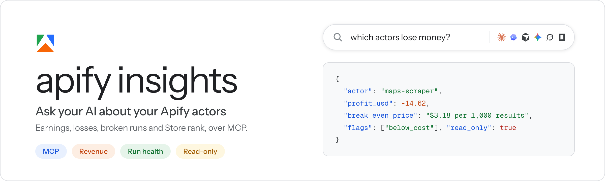

<p align="center">
  
</p>

<h3 align="center">Find the Apify actors that lose money, leak users or need a fix.</h3>

<p align="center">
  Ask your AI about your own account and get exact numbers back:<br>
  profit, break-even prices, failing runs, quality fixes and Store rank.<br>
  <sub>Works in Claude, Codex, Cursor, Gemini, Grok and OpenCode.</sub>
</p>

<p align="center">
  
  
  
  
  <a href="https://github.com/Devansh-365/apify-insights-mcp"></a>
</p>

## 💬 What you can ask

| Ask | You get |
|---|---|
| *"How did I do yesterday?"* | Profit against the same days last month, plus the 3 actors to look at |
| *"Which actors lose money?"* | Each one with the price where it would break even |
| *"Is anything broken?"* | Actors that fail, that Apify flagged, or that charge nothing |
| *"Tell me about maps-scraper"* | Users, runs, price, builds, reviews and 3 months of money |
| *"Which actors are leaking users?"* | Each actor marked Leaking, Rising, Fading or Converting, with the reason and what to do |
| *"What should I fix for quality?"* | Apify's quality suggestions across your actors, ranked by impact |
| *"Where do I rank for tiktok scraper?"* | Your Store search position and who ranks above you |
| *"Compare me with another creator"* | Your public portfolio next to theirs |

## ⚡ Install

**Let your AI agent do it.** Paste this into Claude Code, Codex, Cursor, Gemini CLI or OpenCode:

```text
Set up apify-insights for me by following https://github.com/Devansh-365/apify-insights-mcp/blob/main/skills/setup-apify-insights/SKILL.md
```

**Or run two commands yourself** (needs Node.js 20+):

```bash
npx -y apify-cli login                               # once: connects your Apify account
npx -y github:Devansh-365/apify-insights-mcp setup   # adds it to every AI client you have
```

Restart your AI client and ask *"How did my Apify actors do yesterday?"*

Revenue and profit need a small Chrome extension. Claude Desktop, one-click installs for single clients, updates and fixes are all in **[docs/install.md](docs/install.md)**.

## 💡 Good to know

- **Read-only.** It never changes anything in your Apify account.
- **Runs on your computer.** It talks only to Apify, and your token stays in the Apify CLI login.
- **No guessing.** A number it cannot get shows as "not available", never as zero.
- Every tool and how each metric is worked out: [docs/tools.md](docs/tools.md).

## 🛠️ Development

```bash
npm test             # tests on made-up data
npm run build        # bundles src/ into dist/index.js (committed, so rebuild before you commit)
npm run check:dist   # fails if dist/index.js is out of date
npm run pack:mcpb    # builds the Claude Desktop extension
```

Why it installs this way: [ADR 0001](docs/adr/0001-multi-client-distribution.md). Release notes: [CHANGELOG.md](CHANGELOG.md).

## 📄 License

[MIT](LICENSE), by Devansh Tiwari.

<p align="center">
  <sub>If it saves you a trip to the Apify Console, a ⭐ helps other creators find it.</sub>
</p>
